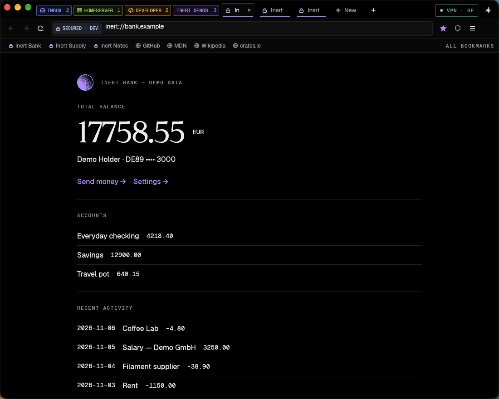

# Inert

**The web, behind glass.** Inert is an application protocol where sites send
*descriptions*, never code — and a small Rust browser that draws them.

- `inert://` sites ship a signed **App Manifest** (screens, actions, design).
  The browser pins the site's key, verifies the signature, then checks every
  screen against the signed template before drawing it. A hacked server can
  show wrong data, but it cannot add a password field.
- Everything else on the web opens in the same browser as **unsecured** tabs,
  rendered by **Servo** (the Rust web engine) in its own process by default,
  or by the system WebKit for Inbox tabs and on demand, with ad & tracker
  blocking in both. 



## What's in the repo

| Path | What |
|---|---|
| `crates/inert-proto` | Message and manifest types, strict deterministic CBOR codec, limits. No I/O, no `unsafe`. |
| `crates/inert-verify` | Every verification rule: signatures, manifest rules, screen/action/open conformance, contrast. |
| `crates/inert-transport` | Length-prefixed frames over TCP + TLS 1.3 (rustls, X25519MLKEM768 preferred), per-direction limits, timeouts, dev trust files. |
| `crates/inert-client` | Client session shared by the browser and tests: dial, pin, verify, fetch assets. |
| `crates/inert-server` | Server SDK, `inert-sign` (keygen / build / check) and the dev runner. |
| `crates/inert-browser` | The browser (egui + wgpu, WebKit web views, Mullvad VPN, Shield, assistant). |
| `crates/inert-servo-ipc` | Messages between the browser and the Servo process (JSON lines). |
| `crates/inert-servo-host` | Servo in its own process; frames go through shared memory. A separate Cargo workspace. |
| `examples/{bank,shop,notes}` | Three demo sites with fake data. |
| `spec/vectors` | Language-independent conformance vectors. |
| `fuzz` | cargo-fuzz targets for the decoder and verifier. |
| `docs/superpowers/specs` | The design spec. |

## Run it

```bash
scripts/demo-sites.sh
```

```bash
scripts/build.sh --release
```

```bash
target/release/inert-browser
```

`scripts/build.sh` builds the browser and the Servo helper (`inert-servo-host`,
its own workspace) into the same `target/` folder. Without the helper, web
pages open in WebKit.

The first launch asks for one thing: your AI provider (Claude or GPT) and,
optionally, your API key (stored in the macOS Keychain).

`target/release/inert-browser --demo` starts with a throwaway demo profile.
`scripts/walkthrough.sh <dir>` runs the scripted feature tour and screenshots it.

## Tests

```bash
cargo test --workspace
```

UI tests that drive the real browser with injected mouse and keyboard events
(71 checks, demo sites must be running). They also sample each process's
memory while they run; `SHOTS=1` saves documentation screenshots too:

```bash
scripts/ui-test.sh target/ui-test
```

Memory with only Inert Bank open (spec §16 baseline):

```bash
scripts/memory-bank.sh target/memory-bank
```

Design check: counts screenshot pixels against the Yön A (Stencil) palette.

```bash
scripts/design-check.py docs/screenshots/01-signin.png
```

Includes end-to-end tests over real TLS for all ten attack scenarios in the
spec (injected password field, extra data, tampered manifest, swapped key,
rollback, invisible text, bad asset, replayed action, unoffered choice,
oversized frame).

```bash
cd fuzz && cargo +nightly fuzz run cbor_decode
```

## Browser features

Tab groups with three special groups — **Inbox** (mail & chat, never
unloaded), **Homeserver** (self-hosted dashboards) and **Developer** (dev
servers, docs, developer tools) — plus bookmarks, history, omnibox with inline
completion and search suggestions, reopen closed tab, find in page, zoom,
downloads, memory saver, native menu with Chrome-style shortcuts, a site
security panel and a manifest inspector, **Shield** (EasyList + EasyPrivacy
compiled into WebKit's content blocker), a **Mullvad VPN** panel, and an
**assistant** that reads inert:// pages from their signed structure and web
pages as untrusted text.

Also: Chrome-style tab shapes with grow/shrink animations and groups that
slide open and closed; a working search box on the new tab page; DuckDuckGo in
its dark theme by default; a day-by-day history with "Clear browsing data";
**Cookies**, a built-in extension that lists and deletes a site's cookies,
keeps none for sites you choose and rejects cookie banners for you; Mullvad
sign-in with just the account number, and log out; and **import from Chrome**
(or Brave, Edge, Arc, Vivaldi, Chromium) as step 2 of the first run or at
`about:import`: bookmarks, history, saved passwords (into the Keychain, filled
from the key in the address bar), cookies so you stay signed in, search engine,
bookmarks bar and startup pages.

Typefaces: Geist Serif, Sans, Mono and Pixel by Vercel (SIL OFL).
