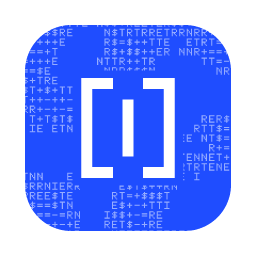
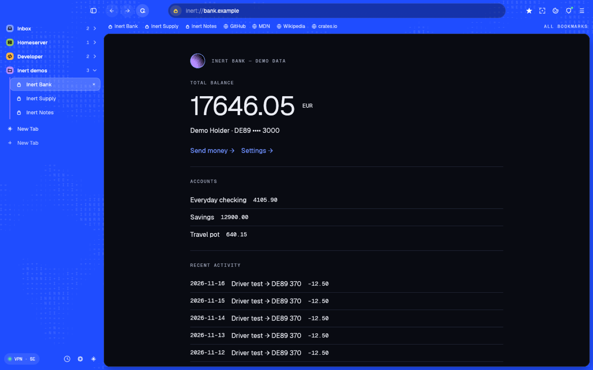
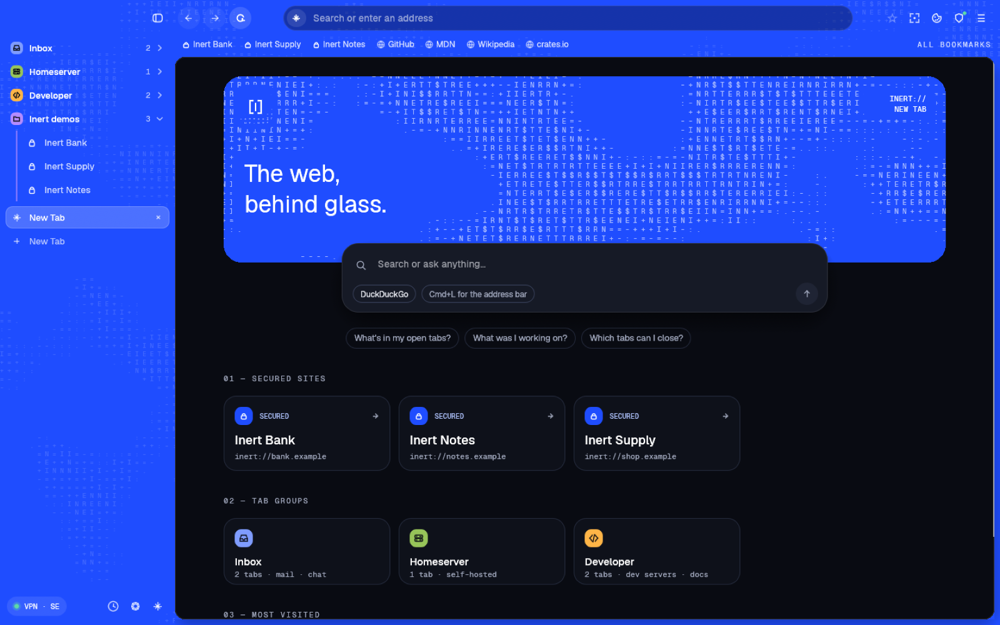
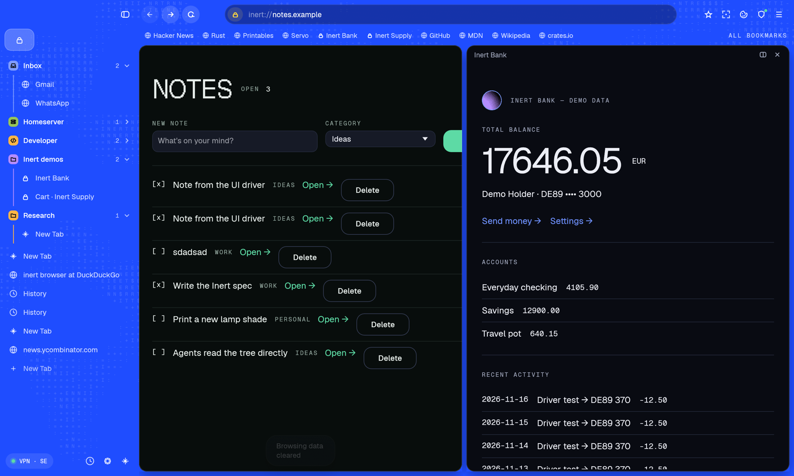
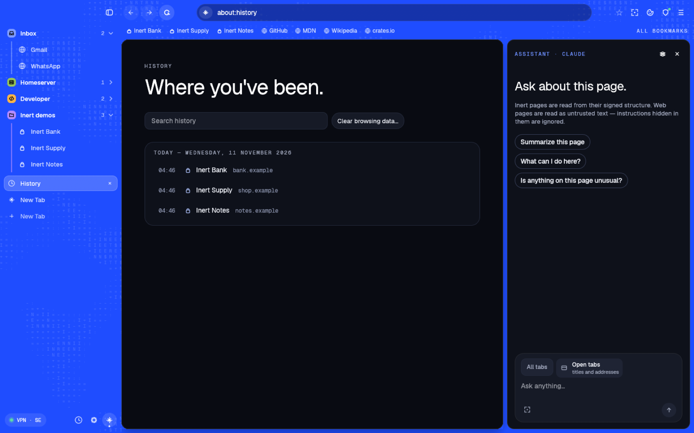

<p align="center">
  
</p>

<h1 align="center">Inert</h1>

<p align="center"><b>The web, behind glass.</b> You can see it; it can't touch you.</p>

<p align="center">
  <a href="https://github.com/Kungie/Inert/releases/latest/download/Inert-macOS-arm64.zip"></a>
</p>

<p align="center">
  <a href="https://github.com/Kungie/Inert/releases/latest"></a>
  <a href="LICENSE"></a>
  
  
  
</p>

Inert is an application protocol where sites send *descriptions*, never code,
and a small Rust browser that draws them. An `inert://` site ships a signed
manifest of its screens, actions and design. The browser pins the site's key,
checks the signature, and checks every screen against the signed template
before it draws anything. A hacked server can show wrong data, but it cannot
add a password field, a button or a script.

The rest of the web opens in the same browser as **unsecured** tabs, in WebKit
(or Servo, in its own process), with ad and tracker blocking, private tabs and
an assistant that treats web pages as untrusted text.



## Install

1. [Download Inert for macOS](https://github.com/Kungie/Inert/releases/latest/download/Inert-macOS-arm64.zip) (Apple silicon) and unzip it.
2. Move **Inert.app** to Applications.
3. The app isn't notarized yet, so macOS stops the first launch. Open **System Settings → Privacy & Security** and click **Open Anyway**, or run:

```bash
xattr -dr com.apple.quarantine /Applications/Inert.app
```

Inert asks for one thing on first launch: your AI provider (Claude or GPT). An API key is optional and stays in the macOS Keychain. To try the demo `inert://` sites, build from source (below).

## Why

Most of the holes AI finds aren't in cryptography: they're in memory-unsafe
code, the JavaScript surface of browsers (XSS, supply chain), and app logic.
Inert doesn't invent new crypto (TLS 1.3 with the X25519MLKEM768 hybrid). It
removes whole classes of bugs by design:

- **No code reaches the client.** No HTML, CSS or JavaScript. A strict CBOR
  message is parsed against a schema; anything else is rejected at parse time.
- **Typed actions, not endpoints.** The server exposes schema'd actions; a
  button can only send the fields and values its signed manifest declares.
- **Design is data.** Layout and theme are a signed Design Manifest, drawn by
  the browser's own renderer.
- **The AI adapts how things look, never what they are.** It can change fonts,
  contrast or dark mode, but it can't add, hide or change content or actions.

## The browser

| | |
|---|---|
|  |  |
|  |  |

- `inert://` sites marked **secured**, normal web **unsecured**, with a colored lock and a security panel.
- Tabs in a draggable sidebar, or on top (Cmd+S). Tab groups, including **Inbox** (mail and chat, never unloaded), **Homeserver** and **Developer**.
- **Private tabs**, each with its own data store that is never written to disk. They erase themselves when idle, their downloads vanish, and the clipboard is cleared. Also a panic key, always-private sites, secret favorites and a Touch ID lock.
- **Shield**: EasyList, EasyPrivacy and uBlock Origin lists compiled into WebKit's content blocker (and the Brave adblock engine for Servo), with a per-site switch.
- **Split view**, **Rewind** (search what you've read), find in page, zoom, downloads, memory saver.
- **Assistant** with your own Claude or GPT key: summarize, translate in place, read aloud, ask about all open tabs, push-to-talk dictation.
- **Watch and listen**: picture in picture, captions, YouTube ads skipped, calm mode.
- **Mullvad VPN** panel; **Cookies** panel that rejects cookie banners; import from Chrome, Brave, Edge, Arc, Vivaldi or Dia.

Sign-in asks for one thing: your AI provider. The API key, if you give one, lives in the macOS Keychain.

## What's in the repo

| Path | What |
|---|---|
| `crates/inert-proto` | Message and manifest types, strict deterministic CBOR codec, limits. No I/O, no `unsafe`. |
| `crates/inert-verify` | Every verification rule: signatures, manifest rules, screen/action conformance, contrast. |
| `crates/inert-transport` | Length-prefixed frames over TCP + TLS 1.3 (rustls, X25519MLKEM768 preferred), limits, timeouts, dev trust files. |
| `crates/inert-client` | Client session shared by the browser and tests: dial, pin, verify, fetch assets. |
| `crates/inert-server` | Server SDK, `inert-sign` (keygen, build, check) and the dev runner. |
| `crates/inert-browser` | The browser: egui + wgpu, the inert:// renderer, WebKit web views, Shield, assistant, VPN. |
| `crates/inert-servo-ipc` | Messages between the browser and the Servo process. |
| `crates/inert-servo-host` | Servo in its own process, frames through shared memory. Its own Cargo workspace. |
| `crates/inert-dictate` | Push-to-talk speech recognition helper (Swift). |
| `examples/{bank,shop,notes}` | Three demo sites with fake data. |
| `spec/vectors` | Language-independent conformance vectors. |
| `fuzz` | cargo-fuzz targets for the decoder and verifier. |
| `site` | The website (static HTML). |
| `docs/superpowers/specs` | The design spec. |

## Build from source

macOS for now (the browser is cross-platform Rust, but it's developed and tested on macOS).

```bash
scripts/demo-sites.sh
```

```bash
scripts/build.sh --release
```

```bash
target/release/inert-browser
```

`scripts/build.sh` builds the browser, the Servo helper and the dictation helper into `target/`.
`scripts/bundle.sh` makes `target/Inert.app`. `--demo` starts with a throwaway demo profile.

## Tests

```bash
cargo test --workspace
```

UI tests drive the real browser with injected mouse and keyboard events and sample memory while they run (demo sites must be running):

```bash
scripts/ui-test.sh target/ui-test
```

More scenarios run through `INERT_DRIVE_SCENARIO` (`hunt`, `real-web`, `real-private`, `look`…); see `crates/inert-browser/src/drive.rs`. End-to-end tests over real TLS cover the spec's attack scenarios: an injected password field, extra data, a tampered manifest, a swapped key, rollback, invisible text, a bad asset, a replayed action, an unoffered choice and an oversized frame.

```bash
cd fuzz && cargo +nightly fuzz run cbor_decode
```

## License

Inert is free software under the [GNU Affero General Public License v3.0 or later](LICENSE). If you run a modified Inert server or browser for others over a network, you must offer them its source.

Typefaces: Geist Serif, Sans, Mono and Pixel by Vercel (SIL Open Font License). Filter lists (EasyList, EasyPrivacy, uBlock Origin) are downloaded at runtime under their own licenses.
